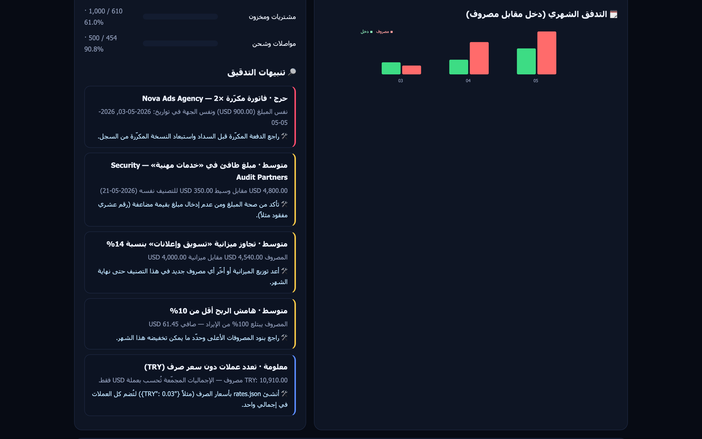
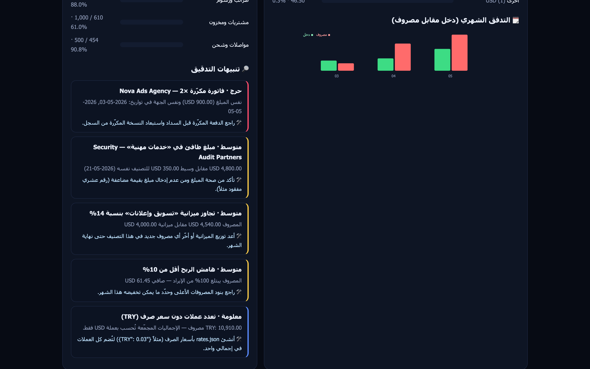
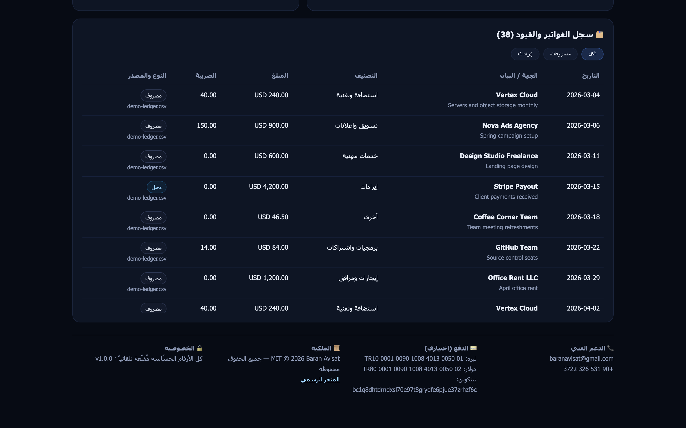

# 🧾 Fin-Guard ZeroBaran

### المنظومة الذاتية الذكية لإدارة الحسابات، الفواتير، والتدقيق المالي

[](https://www.python.org)
[](LICENSE)
[](#%EF%B8%8F-the-free-tech-stack)
[](.github/workflows/finance-report.yml)
[](#%EF%B8%8F-%D8%A7%D9%84%D8%B7%D8%A8%D9%82%D8%A7%D8%AA-%D8%A7%D9%84%D8%A8%D8%B1%D9%85%D8%AC%D9%8A%D8%A9-software-architecture)

**Fin-Guard ZeroBaran** نظام ذكي متكامل لقراءة وفلترة الفواتير، تصنيف المصروفات والإيرادات، تتبع التدفقات النقدية، وإعداد التقارير المالية والضريبية آلياً — دون دفع دولار واحد لأي برنامج محاسبة مدفوع، وبموارد مجانية بالكامل.

> صُمّم ليعمل **محلياً وبلا إنترنت**: استخراج الأرقام وتصنيف البنود وكشف الشذوذ كلها حتمية على جهازك.
> أنت وحدك من يُفعّل مزوّداً ذكياً اختيارياً (Gemini / Groq / OpenRouter / Ollama) إذا أردت تحليلأً أعمق.

---

## 📋 لماذا تتمنى كل شركة وكل فرد الحصول عليه؟

- **توفير مالي فلكي:** اشتراكات برامج الإدارة المالية والمحاسبية تكلف الشركات مبالغ طائلة سنوياً؛ هذا النظام يؤدي نفس الغرض باحترافية تامة وبتكلفة صفر.
- **الأتمتة الشاملة لإدخال البيانات (Zero Manual Entry):** لا داعي لإدخال الأرقام يدوياً؛ ترسل صورة الفاتورة أو وصل الدفع أو ملف PDF أو إشعاراً بريدياً فيتولى النظام قراءته وترتيبه في السجلات فوراً.
- **السيادة والسرية المالية المطلقة:** بياناتك المالية وفواتيرك وأرباحك لا تغادر خوادمك الخاصة أبداً ولا تُشارك مع أي جهات خارجية.

---

## 🛠️ الموارد المجانية البحتة (The Free Tech Stack)

| المكون الأساسي | الخدمة / التقنية المجانية | دورها في المشروع |
|---|---|---|
| محرك التشغيل والمتابعة المجدولة (Cron) | **GitHub Actions** | جدولة التقارير الأسبوعية، معالجة `finance/inbox` عند إضافته، وإرفاق المخرجات كـ Artifacts. |
| محرك قراءة واستخراج النصوص (OCR) | **Python + PyMuPDF / Tesseract** | قراءة الفواتير الورقية وملفات PDF واستخراج الأرقام والتواريخ والبنود (عربي/إنجليزي/تركي). |
| العقل المحاسبي والتصنيف | **Gemini API / Groq API / Ollama (Free Tiers)** | فهم بنود الفاتورة، تصنيفها، وكشف التكرار أو الخطأ — **اختياري تماماً**. |
| قاعدة البيانات والسجلات المالية | **Supabase (PostgreSQL Free Tier)** | أرشفة القيود والتقارير التاريخية عبر `supabase/schema.sql` (RLS مفعّل). |
| قناة الاستقبال والتنبيهات | **Telegram Bot API + Streamlit** | إرسال الفواتير والتنبيهات المالية الفورية ولوحة تحكم مرئية. |

---

## 📐 البنية البرمجية (Software Architecture)

```
[إرسال الفاتورة: صورة · PDF · CSV · TXT · EML]
                          │
                          ▼
[طبقة الالتقاط والقراءة  finguard/extract.py + parse.py]
        PyMuPDF أو pdftotext أو Tesseract OCR — عربي/إنجليزي/تركي
                          │
                          ▼
[العقل المحلي الحتمي  finguard/classify.py + anomalies.py]
        تصنيف محاسبي + قواعد شذوذ + محرّك ذكي اختياري (Gemini/Groq)
                          │
                          ▼
[الدفتر المزدوج  finguard/ledger.py  ──►  reports/transactions.json|csv]
                          │
                          ▼
[التقارير والتنبيهات  finguard/report.py + alert.py + serve]
        HTML داكن · CSV · JSON · Telegram · Streamlit (اختياري)
```

### الطبقات الأربع برمجياً

1. **طبقة الالتقاط والقراءة (Ingestion & OCR):** تقرأ PDF (نصّي أو ممسوح ضوئياً)، الصور عبر Tesseract، ملفات CSV/TSVB، الرسائل البريدية `.eml` والنصوص الحرة — وتستخرج القيمة والتاريخ والجهة والضريبة بدقة.
2. **العقل المحاسبي (Local-First AI Core):** قاموس عربي/إنجليزي/تركي يصنّف كل قيد إلى فئة محاسبية، ثم محرك شذوذ يكشف التكرار، القفزات غير المتوقعة، انحرافات الميزانية، الشذوذ الموسمي، والمهام المتكررة. وإذا ضبطت مفتاحاً أُضيف تفسير نموذج لغوي فوق النتائج.
3. **طبقة الأرشيف (Persistence & Ledger):** دفتر قيود بنمط القيد المزدوج (سند/دائن) مع سجل دفعات وتقرير تاريخي لكل تشغيلة.
4. **طبقة التقارير والتوصيل (Reporting & Delivery):** تقرير HTML جاهز للطباعة، CSV/JSON للتصدير، تنبيه تليجرام، وخادم محلي `serve` أو Streamlit.

---

## ⚙️ التشغيل السريع

### المتطلبات الأساسية

- Python **3.9+** — النواة تعمل بمكتبة Python القياسية فقط (صفر تبعيات إجبارية).
- اختياري: `tesseract-ocr` للصور · `poppler-utils`/PyMuPDF لـ PDF · مفتاح AI · Supabase · بوت تليجرام.

```bash
git clone https://github.com/aoodiakdiro0001-ops/fin-guard-zerobaran.git
cd fin-guard-zerobaran
python3 -m finguard init        # يُنشئ finance/inbox و budget.json و .env
python3 -m finguard doctor      # يعرض جاهزية كل المحرّكات
python3 -m finguard ingest finance/inbox samples
python3 -m finguard report      # reports/report.html + transactions.csv + .json
python3 -m finguard serve       # http://127.0.0.1:8501/report.html
```

> جرّب مباشرة على الفواتير النموذجية: `python3 -m finguard ingest samples --label "تجربة"`.

### إعداد الـ Secrets في GitHub

`Settings → Secrets and variables → Actions` ثم أضف (كلها اختيارية):

`GEMINI_API_KEY` · `GROQ_API_KEY` · `SUPABASE_URL` · `SUPABASE_SERVICE_ROLE_KEY` · `TELEGRAM_BOT_TOKEN` · `TELEGRAM_CHAT_ID` · `BASE_CURRENCY`

وأنشئ مخطط قاعدة البيانات بتشغيل ملف [supabase/schema.sql](supabase/schema.sql) في SQL Editor.

### أوامر المفهرس

| الأمر | الوظيفة |
|---|---|
| `finguard init` | تهيئة المجلدات: صندوق الفواتير، الميزانية، ملف البيئة |
| `finguard doctor` | تشخيص المحرّكات والمفاتيح ومسارات الإخراج |
| `finguard ingest [path]` | قراءة وتصنيف فواتير ثم كتابة الدفتر والتقارير |
| `finguard report` | إعادة بناء التقرير من قيود محفوظة دون إعادة قراءة |
| `finguard history` | سجل الدفعات (إيراد/مصروف/صافي لكل فترة) |
| `finguard send` | إرسال ملخص التقرير إلى تليجرام |
| `finguard serve` | خادم محلي لعرض التقرير في المتصفح |

خيارات مفيدة لـ `ingest`: `--budget budget.json` · `--notify` · `--no-ai` · `--label "نوفمبر"` · `--out reports`.

---

## 🖼️ لقطات التقارير

<table>
  <tr>
    <td align="center"><b>لوحة الملخص المالي</b></td>
    <td align="center"><b>تنبيهات التدقيق والتدفق الشهري</b></td>
    <td align="center"><b>سجل الفواتير والقيود</b></td>
  </tr>
  <tr>
    <td></td>
    <td></td>
    <td></td>
  </tr>
</table>

---

## 🧭 طريقة العمل خطوة بخطوة (End-to-End Workflow)

1. **الاستلام:** صوّر فاتورة أو أرسل ملف PDF أو ضعه في `finance/inbox` (أو عبر تليجرام).
2. **المعالجة الآلية:** يستخرج النظام الأرقام والبنود خلال ثوانٍ، عربياً كانت أم إنجليزياً.
3. **التصنيف والتسجيل:** يُصنَّف القيد محاسبياً ويُقيَّد في الدفتر مع درجة ثقة ومصدر.
4. **النتيجة الفورية:**
   > 💰 تم تسجيل المصروف: **$149.00** لصالح **DigitalOcean** — فئة: *Hosting & Cloud*.
   > 📊 ملاحظة مالية: مصروفات هذه الفترة أعلى بنسبة 12% من متوسط آخر ٣ أشهر.

---

## 📁 هيكل المشروع

```
fin-guard-zerobaran/
├── finguard/            # النواة (بدون تبعيات إجبارية)
│   ├── extract.py       # قراءة PDF/صور/CSV/EML/نص + OCR
│   ├── parse.py         # استخراج التاريخ/المبلغ/الجهة/الضريبة
│   ├── classify.py      # التصنيف المحاسبي (عربي/إنجليزي/تركي)
│   ├── anomalies.py     # كشف التكرار والشذوذ وتجاوز الميزانية
│   ├── ledger.py        # الدفتر المزدوج وسجل الدفعات
│   ├── report.py        # HTML/CSV/JSON + الإجماليات والاتجاهات
│   ├── alert.py         # تنبيهات تليجرام
│   ├── ai.py            # مزوّدات ذكية اختيارية (Gemini/Groq/OpenRouter/Ollama)
│   ├── store.py         # مزامنة Supabase اختيارية
│   └── cli.py           # واجهة الأوامر
├── samples/             # فواتير نموذجية للتجربة الفورية
├── supabase/schema.sql  # مخطط القاعدة (مع RLS)
├── dashboard/app.py     # لوحة Streamlit اختيارية
├── .github/workflows/   # التقرير المجدول على GitHub Actions
├── budget.example.json  # نموذج ميزانية لكل فئة
├── SUPPORT.md           # الدعم الفني وحقوق الملكية
└── LICENSE              # MIT © 2026 Baran Avisat
```

---

## 🚀 المزايا الرئيسية

- **صفر تكلفة وصفر تبعيات إجبارية** — يُشغَّل على أي حاسبة بلا `pip install`.
- **يعمل بلا إنترنت** — الاستخراج والتصنيف والشذوذ كلها محلية وحتمية.
- **يدعم العربية والإنجليزية والتركية** في التواريخ والمبالغ والبنود.
- **كشف التكرار المالي** قبل السداد ببصمة (جهة + مبلغ + تاريخ).
- **تقرير مالي فاخر** HTML داكن + CSV/JSON جاهزان للطباعة والمحاسب.
- **جدولة آلية أسبوعية** عبر GitHub Actions مع إرفاق التقارير تلقائياً.

---

## 📞 الدعم والمساهمة

- 📧 **البريد:** `baranavisat@gmail.com`
- 💬 **واتساب:** `+90 531 326 3722`
- 🐛 تقارير الأخطاء مرحّب بها عبر [Issues](../../issues)
- 📄 التفاصيل الكاملة في [SUPPORT.md](SUPPORT.md)

**© 2026 Baran Avisat — جميع الحقوق محفوظة.**

---

## 📜 الترخيص

مُصدر برخصة **MIT** — انظر [LICENSE](LICENSE).

> إخلاء مسؤولية: أداة مساعدة للتدقيق المالي الداخلي وليست استشارة محاسبية أو ضريبية معتمدة.
